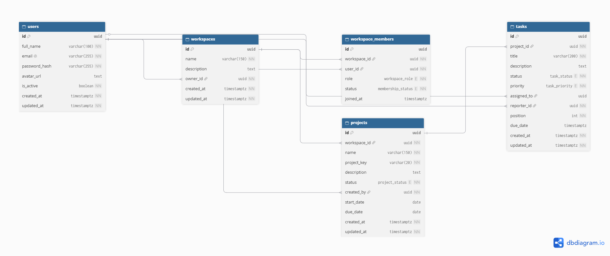

# TaskMatrix – Enterprise Agile Project Management Platform

## 1. Project Overview

TaskMatrix is a full-stack Agile project management platform designed to help software development teams organize projects, assign tasks, track progress, manage deadlines, and collaborate efficiently through a centralized workspace.

Inspired by modern project management platforms such as Jira, Asana, and Trello, TaskMatrix provides an intuitive interface with Kanban boards, task management, team collaboration, role-based access control, and project analytics.

The platform aims to simplify project workflows and improve team productivity through centralized project tracking and real-time activity updates.

## 2. Project Information

- **Project Name:** TaskMatrix
- **Project Type:** Full-Stack Web Application
- **Designated Track:** Fullstack Development
- **Project Category:** SaaS / Agile Project Management
- **Development Duration:** 5 Weeks
- **Architecture:** Modular Monolith

## 3. Problem Statement

Software teams often struggle to manage tasks, deadlines, team responsibilities, and project progress across multiple tools.

TaskMatrix addresses these challenges by providing a centralized platform where teams can create projects, assign responsibilities, monitor task status, and track project activities.

## 4. Project Objectives

- Simplify project and task management.
- Improve team collaboration and accountability.
- Provide visual project progress tracking.
- Manage task priorities and deadlines.
- Implement secure role-based access control.
- Provide real-time activity updates.
- Deliver a responsive and user-friendly interface.

## 5. Technology Stack

### Frontend
- Next.js
- TypeScript
- Tailwind CSS
- Shadcn UI
- dnd-kit
- Axios

### Backend
- Python
- FastAPI
- SQLAlchemy
- Pydantic
- JWT Authentication
- WebSockets

### Database
- PostgreSQL

### Development and Deployment
- Git and GitHub
- Swagger / OpenAPI
- Vercel (Frontend)
- Render (Backend)

## 6. User Roles

1. **Workspace Owner:** Full control over workspace settings, members, and projects.
2. **Admin:** Manages workspace members, projects, and permissions.
3. **Project Manager:** Creates and manages projects, tasks, assignments, and deadlines.
4. **Member:** Views accessible projects and manages assigned tasks.

## 7. Core Features (Prioritized)

### P0 – Essential Features

- User registration and login.
- Secure authentication and authorization.
- Workspace creation and management.
- Workspace member management.
- Project creation, editing, viewing, and archiving.
- Task creation, editing, deletion, and assignment.
- Task status management.
- Drag-and-drop Kanban board.
- Task priorities and due dates.
- Role-based access control.

### P1 – Important Features

- Project overview dashboard.
- Task statistics and progress tracking.
- Team activity feed.
- In-app notifications.
- Search, filtering, and sorting.
- Responsive mobile interface.
- Real-time task and activity updates.

### P2 – Advanced Features

- AI-powered task summaries.
- AI-generated task suggestions.
- Advanced project analytics.
- Email notifications.
- Advanced reporting.

## 8. Main Application Modules

1. Authentication Module
2. Workspace Management Module
3. Project Management Module
4. Task Management Module
5. Kanban Board Module
6. Team and Role Management Module
7. Dashboard and Analytics Module
8. Activity and Notification Module
9. AI Integration Module

## 9. Database Design

The initial relational database will contain five core tables:

- Users
- Workspaces
- Workspace Members
- Projects
- Tasks

### Entity Relationships

- One user can own multiple workspaces.
- One workspace can have multiple members.
- One workspace can contain multiple projects.
- One project can contain multiple tasks.
- One user can be assigned multiple tasks.
- Each task belongs to one project.

Additional tables for activity logs and notifications may be introduced during feature expansion.

## Database Entity Relationship Diagram

TaskMatrix uses PostgreSQL as its relational database.

The initial database consists of five core tables:
Users, Workspaces, Workspace Members, Projects, and Tasks.

## 10. System Architecture

TaskMatrix follows a modular monolithic architecture.

The Next.js frontend communicates with the FastAPI backend through REST APIs. The backend handles authentication, authorization, business logic, and database operations through SQLAlchemy.

PostgreSQL stores application data, while WebSockets support real-time activity updates.

### Architecture Flow

User → Next.js Frontend → FastAPI Backend → SQLAlchemy ORM → PostgreSQL Database

WebSocket connections will handle real-time updates where required.

## 11. UI/UX Design

The application will follow a modern SaaS dashboard design system.

Planned screens:

1. Authentication and Registration.
2. Workspace Dashboard.
3. Project Overview.
4. Kanban Board.
5. Task Details View.
6. Team Management.

The interface will support desktop, tablet, and mobile screen sizes.

**Figma Design:** [Add Public Figma Link Here]

## 12. Security and Non-Functional Requirements

- Secure password hashing.
- JWT-based authentication.
- Backend-enforced role permissions.
- Input validation using Pydantic.
- Protected API endpoints.
- Workspace-level data isolation.
- Responsive design.
- Consistent API error handling.
- Database transaction management.

## 13. Development Roadmap

| Sprint | Planned Work |
|---|---|
| Sprint 13 | PRD, UI/UX and architecture |
| Sprint 14 | MVP and authentication |
| Sprint 15 | CRUD operations and core modules |
| Sprint 16 | AI integration and UX improvements |
| Sprint 17 | Testing, CI/CD and deployment |

## 14. Future Enhancements

- Subscription and payment integration.
- Advanced analytics and reports.
- Email and external integrations.
- Advanced automation workflows.
- Calendar integrations.

## 15. Project Status

Currently in the planning and architecture phase.

## 16. Author

**Fullstack Developer**

ProDesk Capstone – Sprint 13

---

*TaskMatrix – Plan Smarter. Collaborate Better. Deliver Faster.*